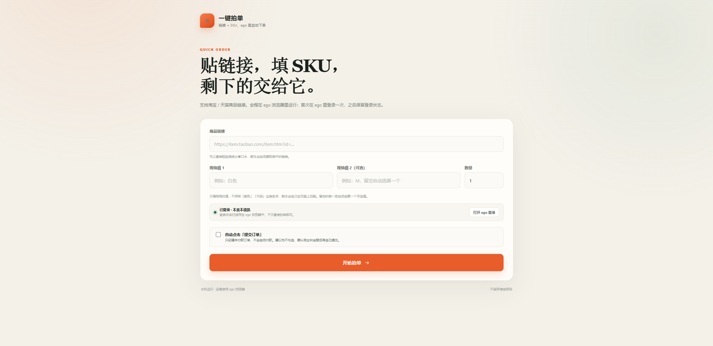
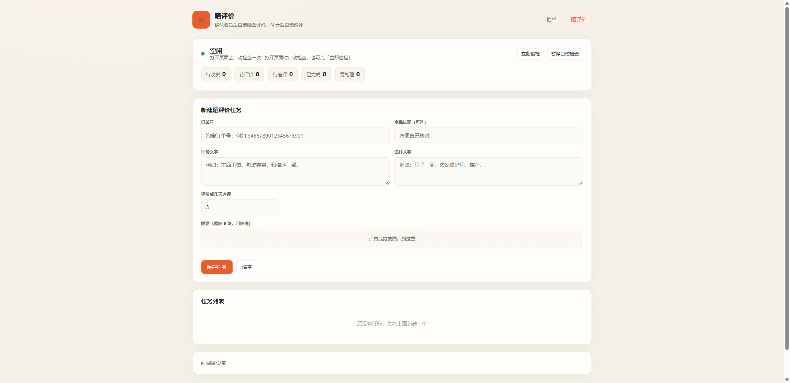

# 一键拍单

本地淘宝 / 天猫「贴链接 + 填 SKU」自动拍单工具。全程在 **ego 浏览器**里运行，不另开 Edge / Chrome，不需要第三方依赖。



## 怎么用

1. 先确认 ego lite 已经安装并在运行：

   ```powershell
   ego-browser --version
   ```

2. 启动本工具：

   ```powershell
   cd D:\AI\拍单晒图
   npm start
   ```

   或者双击 `start.bat`。服务启动后会自动在 ego 里打开 <http://127.0.0.1:4321>。
   如果服务已经在运行，也可以执行 `npm run open` 在 ego 里重新打开页面。

3. 点「打开 ego 登录」，在 ego 里登录一次淘宝，然后点「我已完成登录」。登录状态保存在 ego 浏览器里，下次不用再登。

   如果 ego 里已经登录过淘宝（比如平时就在 ego 里逛淘宝），也可以跳过这一步，直接执行：

   ```powershell
   npm run detect-login
   ```

   它会用 ego 打开淘宝首页确认登录态，把账号名写进 `data/login-state.json`，页面刷新后显示已登录。

   不需要在页面里填账号：页面上的「已登录 · 账号名」就是 ego 里当前登录的那个号。要换账号，点「打开 ego 登录」重新登录，再点「我已完成登录」，工具会自动读回新的账号名。

4. 填商品链接和两个规格值，点「开始拍单」：
   - 链接可以直接粘贴淘宝分享口令，工具会自动提取链接。
   - 只填规格的**值**：第一格例如 `白色`，第二格例如 `M`；不用写「颜色」「尺码」这类名字，脚本会自己在页面上匹配。
   - 只填第一格时，第二级规格会默认选第一个可选值。
   - 默认只走到订单确认页，核对地址和金额后自己点「提交订单」。
   - 勾选「自动点击提交订单」后，工具会提交一个**未付款**订单，不会操作支付。

## 为什么在 ego 里跑

工具不启动自己的浏览器，而是调用本机 `ego-browser nodejs`，在 ego 里新建一个任务页完成操作。好处是：

- 复用你在 ego 里已有的淘宝登录态；
- 不需要把淘宝密码交给任何脚本；
- 页面停在哪一步，你都能直接在 ego 里接管。

## SKU 规则

- 页面固定两个输入框：规格值 1、规格值 2（可选），填的只是选项文字，例如 `白色` 和 `M`。
- 脚本按文字匹配页面上每一个规格组，匹配不到的组会默认选第一个可选值。
- 页面结构差异太大找不到选项时，日志会提示，直接在 ego 页面里手动点一下即可。

## 晒评价（自动评价 + 追评）

拍单页面点右上角「晒评价」，或直接打开 <http://127.0.0.1:4321/review>。



1. 每笔订单单独建任务：订单号 + 评价文字 + 追评文字 + 追评天数 + 晒图（最多 9 张）。
2. **不做定时巡检**：每次打开 `/review` 页面会自动检查一次（也可点「立即巡检」）。订单「确认收货」后自动去评价（5 星 + 文字 + 图片）。
3. 评价满 N 天后自动追评，追评文字用任务里那一份；超出可追评窗口会标记过期。
4. 任务状态：待开始 → 待收货 → 待评价 → 已评价 / 待追评 → 已完成；遇到验证码、登录失效会转「需处理」，等你在 ego 里手动处理后点「重试」。
5. 页面关掉不会后台跑；下次打开页面时会把到期的任务补跑。

### 追评是怎么判断的

- 评价成功那一刻记下 `reviewedAt`，追评到期时间 `followupDueAt = reviewedAt + 任务里的追评天数`。
- 每次检查时比较当前时间：`现在 >= followupDueAt` 且任务处于「待追评」，就去追评；没到期就继续等。
- 另外有窗口保护：超过 `reviewedAt + 180 天` 还没追评，任务直接标记「已过期」，不会硬追。
- 因为不做定时巡检，追评实际发生在「到期之后的第一次检查」，也就是你下次打开页面时。

对应代码：[review-store.js](review-store.js) 的 `planFor()` 和 `applyResult()`。
5. 调度随服务常驻，页面关掉也会继续跑；静音时段默认 23:30–08:00（可改）。

## 目录

```
quick-server.js      本地服务：参数校验、任务状态、调用 ego，挂载 /review 页面
ego-driver.js        生成 ego 任务脚本（下单 / 登录）
review-store.js      晒评价任务的数据层（data/reviews.json、到期计算）
review-driver.js     生成晒评价的 ego 脚本（巡检 / 评价 / 追评）
review-scheduler.js  按需检查与串行执行
review-api.js        /api/review/* 接口
runner-lock.js       拍单与晒评价共用的进程内互斥锁
detect-login.js      检测 ego 里的淘宝登录态，写入 data/login-state.json
login-check.js       登录态检测的复用实现（供 detect-login 与服务调用）
quick/               页面（index.html / app.js / styles.css）
quick/review/        晒评价页面
data/ego-runs/       拍单任务的临时脚本、进度和结果
data/reviews.json    晒评价任务数据（不入库，自动生成）
data/review-images/  晒评价图片
data/login-state.json 登录状态标记（真正的 Cookie 在 ego 里）
test/                接口与纯函数测试
```

## 测试

```powershell
npm test              # 单元 + 接口测试
npm run test:review   # 晒评价端到端（用 mock 页面在 ego 里跑一遍）
```

## 说明

- 只创建未付款订单，不包含支付、代付、批量刷单等功能。
- 工具会按 ego 里当前登录的账号记录任务，换账号就重新登录一次；真正的登录态由 ego 浏览器统一保存。
- 晒评价不做定时巡检：打开页面时检查；停机或没开页面期间到期的任务，下次打开页面时补跑。
- 旧的「派单台」看板仍保留：`npm run dashboard`。
